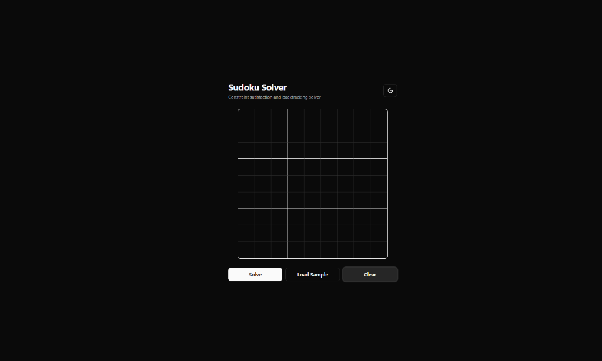
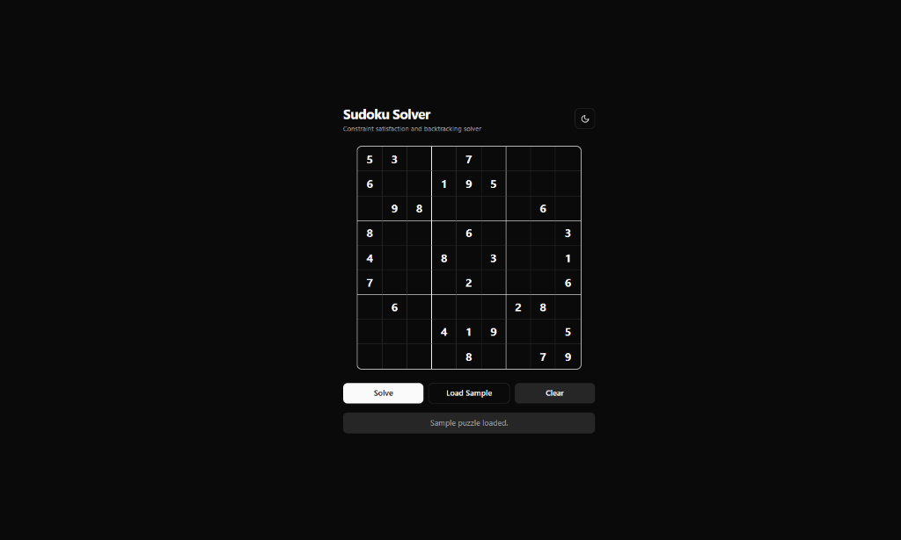
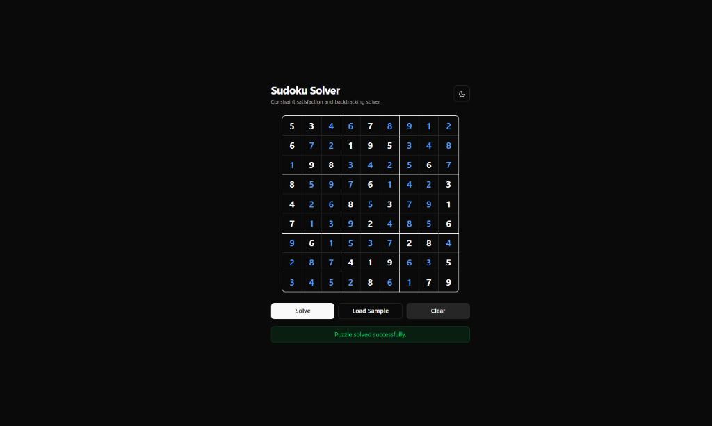

# Sudoku Solver

A full-stack Sudoku solver application with a C++ backend and a React frontend. The backend uses constraint satisfaction and backtracking to solve 9x9 puzzles. The frontend provides an interactive board to enter numbers, load sample puzzles, and view solutions.

## Screenshots

### Empty Board
The initial grid where you can manually type numbers or navigate using arrow keys.



### Loading a Puzzle
Clicking Load Sample populates the grid with an initial puzzle.



### Solved State
Clicking Solve sends the board to the C++ backend and displays the completed solution.



## Prerequisites

- C++ compiler with C++11 support (such as g++)
- Node.js (version 18 or newer) and npm

## Running the Application

### 1. Start the Backend

Open a terminal and run the following commands:

Windows:
```powershell
cd backend
g++ -O2 main.cpp -lws2_32 -o main.exe
.\main.exe
```

Linux or macOS:
```bash
cd backend
g++ -O2 main.cpp -o main
./main
```

The backend starts a local HTTP server listening on http://localhost:5000.

Optional: To test solving the puzzle directly in the terminal without starting the server, run:
```powershell
.\main.exe --cli
```

### 2. Start the Frontend

Open a second terminal and run:

```powershell
cd frontend
npm install
npm run dev
```

Open http://localhost:5173 in your browser.

## Features

- Interactive 9x9 Sudoku grid with keyboard and arrow key navigation
- One-click solving powered by the C++ backtracking engine
- Sample puzzle loader
- Clear grid action
- Light and dark mode support
- Input validation to reject invalid or conflicting boards
